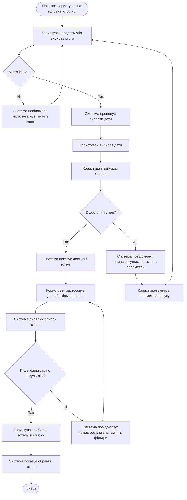

# Feature: Пошук та фільтрація готелів
## Use Case: Search and filter hotels

Основні учасники — користувач і система TravelMate. Користувач може бути зареєстрованим або незареєстрованим: він вибирає місто й дати, шукає готелі, застосовує фільтри та вибирає готель зі списку. Діаграма також показує, що відбувається, якщо міста не існує або за вибраними параметрами немає результатів.

